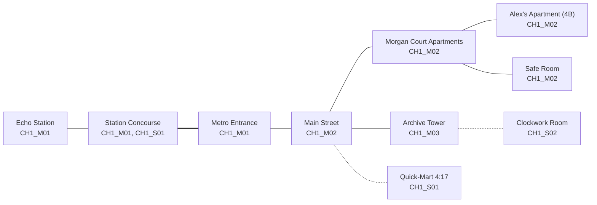
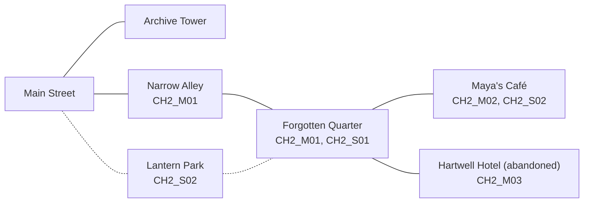
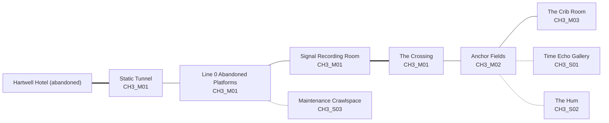
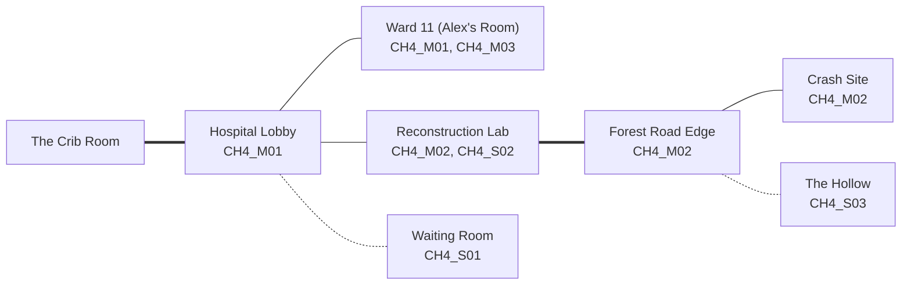
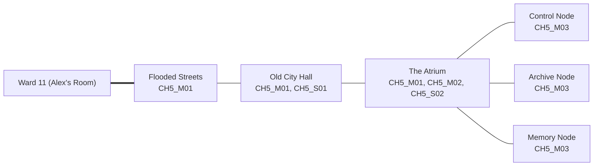
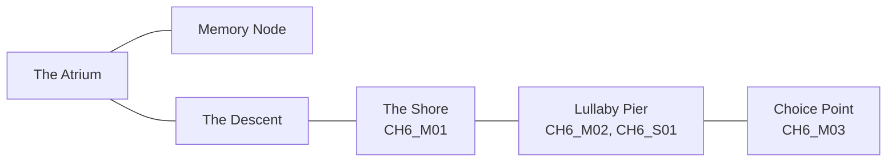

# Level Flow Diagrams

Generated from `tools/world_data.py`. Every main mission has a validated route using only routes open in that chapter.

## Chapter 1

| Mission | Type | Route |
|---|---|---|
| CH1_M01 Static | Main | Echo Station → Station Concourse → Metro Entrance |
| CH1_M02 The Empty Plaza | Main | Metro Entrance → Main Street → Morgan Court Apartments → Safe Room → Morgan Court Apartments → Alex's Apartment (4B) |
| CH1_M03 Catalogue Desk | Main | Alex's Apartment (4B) → Morgan Court Apartments → Main Street → Archive Tower |
| CH1_S01 Lost Luggage | Optional | Archive Tower → Main Street → Metro Entrance → Station Concourse → Metro Entrance → Main Street → Quick-Mart 4:17 |
| CH1_S02 The 4:17 Clock | Optional | Archive Tower → Clockwork Room |

## Chapter 2

| Mission | Type | Route |
|---|---|---|
| CH2_M01 Faceless Crowd | Main | Archive Tower → Main Street → Narrow Alley → Forgotten Quarter |
| CH2_M02 Maya's Café | Main | Forgotten Quarter → Maya's Café |
| CH2_M03 The Seat Without a Name | Main | Maya's Café → Forgotten Quarter → Hartwell Hotel (abandoned) |
| CH2_S01 Calm the Whispering Man | Optional | Hartwell Hotel (abandoned) → Forgotten Quarter |
| CH2_S02 Rebuild the Wedding Photo | Optional | Hartwell Hotel (abandoned) → Forgotten Quarter → Lantern Park → Forgotten Quarter → Maya's Café |

## Chapter 3

| Mission | Type | Route |
|---|---|---|
| CH3_M01 Crossing | Main | Hartwell Hotel (abandoned) → Static Tunnel → Line 0 Abandoned Platforms → Signal Recording Room → The Crossing |
| CH3_M02 Shift Anchors | Main | The Crossing → Anchor Fields |
| CH3_M03 The Crib Room | Main | Anchor Fields → The Crib Room |
| CH3_S01 Time Echo Gallery | Optional | The Crib Room → Anchor Fields → Time Echo Gallery |
| CH3_S02 The Hum | Optional | The Crib Room → Anchor Fields → The Hum |
| CH3_S03 The Maintenance Log | Optional | The Crib Room → Anchor Fields → The Crossing → Signal Recording Room → Line 0 Abandoned Platforms → Maintenance Crawlspace |

## Chapter 4

| Mission | Type | Route |
|---|---|---|
| CH4_M01 Hospital Echo | Main | The Crib Room → Hospital Lobby → Ward 11 (Alex's Room) |
| CH4_M02 The Crash | Main | Ward 11 (Alex's Room) → Hospital Lobby → Reconstruction Lab → Forest Road Edge → Crash Site |
| CH4_M03 What Maya Knows | Main | Crash Site → Forest Road Edge → Reconstruction Lab → Hospital Lobby → Ward 11 (Alex's Room) |
| CH4_S01 Maya's Journal | Optional | Ward 11 (Alex's Room) → Hospital Lobby → Waiting Room |
| CH4_S02 Voicemail Archive | Optional | Ward 11 (Alex's Room) → Hospital Lobby → Reconstruction Lab |
| CH4_S03 Totem Hollow | Optional | Ward 11 (Alex's Room) → Hospital Lobby → Reconstruction Lab → Forest Road Edge → The Hollow |

## Chapter 5

| Mission | Type | Route |
|---|---|---|
| CH5_M01 The Atrium | Main | Ward 11 (Alex's Room) → Flooded Streets → Old City Hall → The Atrium |
| CH5_M02 The Argument | Main | The Atrium |
| CH5_M03 Three Nodes | Main | The Atrium → Control Node → The Atrium → Archive Node → The Atrium → Memory Node |
| CH5_S01 Elias's Recordings | Optional | Memory Node → The Atrium → Old City Hall |
| CH5_S02 The Unsent Letter | Optional | Memory Node → The Atrium |

## Chapter 6

| Mission | Type | Route |
|---|---|---|
| CH6_M01 The Shore | Main | Memory Node → The Atrium → The Descent → The Shore |
| CH6_M02 The Lullaby | Main | The Shore → Lullaby Pier |
| CH6_M03 The Last Memory | Main | Lullaby Pier → Choice Point |
| CH6_S01 Deep Fragment Trio | Optional | Choice Point → Lullaby Pier |

## Mission to location matrix

| Mission | Name | Type | Chapter | Locations |
|---|---|---|---|---|
| CH1_M01 | Static | Main | 1 | `LOC_UM_ECHO_STATION`, `LOC_UM_CONCOURSE`, `LOC_EC_METRO_ENTRANCE` |
| CH1_M02 | The Empty Plaza | Main | 1 | `LOC_EC_MAIN_STREET`, `LOC_EC_APT_BLDG`, `LOC_EC_SAFE_ROOM`, `LOC_EC_ALEX_APT` |
| CH1_M03 | Catalogue Desk | Main | 1 | `LOC_EC_ARCHIVE_TOWER` |
| CH1_S01 | Lost Luggage | Optional | 1 | `LOC_UM_CONCOURSE`, `LOC_EC_CONV_STORE` |
| CH1_S02 | The 4:17 Clock | Optional | 1 | `LOC_EC_HID_CLOCK_ROOM` |
| CH2_M01 | Faceless Crowd | Main | 2 | `LOC_EC_ALLEY`, `LOC_EC_FORGOTTEN_QUARTER` |
| CH2_M02 | Maya's Café | Main | 2 | `LOC_EC_MAYA_CAFE` |
| CH2_M03 | The Seat Without a Name | Main | 2 | `LOC_EC_ABANDONED_BLDG` |
| CH2_S01 | Calm the Whispering Man | Optional | 2 | `LOC_EC_FORGOTTEN_QUARTER` |
| CH2_S02 | Rebuild the Wedding Photo | Optional | 2 | `LOC_EC_PARK`, `LOC_EC_MAYA_CAFE` |
| CH3_M01 | Crossing | Main | 3 | `LOC_UM_TUNNEL_STATIC`, `LOC_UM_ABANDONED_PLATFORMS`, `LOC_UM_RECORDING_ROOM`, `LOC_DL_CROSSING` |
| CH3_M02 | Shift Anchors | Main | 3 | `LOC_DL_ANCHOR_FIELDS` |
| CH3_M03 | The Crib Room | Main | 3 | `LOC_DL_CRIB_ROOM` |
| CH3_S01 | Time Echo Gallery | Optional | 3 | `LOC_DL_ECHO_GALLERY` |
| CH3_S02 | The Hum | Optional | 3 | `LOC_DL_THE_HUM` |
| CH3_S03 | The Maintenance Log | Optional | 3 | `LOC_UM_HID_MAINTENANCE` |
| CH4_M01 | Hospital Echo | Main | 4 | `LOC_MH_LOBBY`, `LOC_MH_WARD_ALEX` |
| CH4_M02 | The Crash | Main | 4 | `LOC_MH_RECON_LAB`, `LOC_BF_ROAD_EDGE`, `LOC_BF_CRASH_SITE` |
| CH4_M03 | What Maya Knows | Main | 4 | `LOC_MH_WARD_ALEX` |
| CH4_S01 | Maya's Journal | Optional | 4 | `LOC_MH_WAITING_ROOM` |
| CH4_S02 | Voicemail Archive | Optional | 4 | `LOC_MH_RECON_LAB` |
| CH4_S03 | Totem Hollow | Optional | 4 | `LOC_BF_HOLLOW` |
| CH5_M01 | The Atrium | Main | 5 | `LOC_SD_FLOODED_STREETS`, `LOC_SD_OLD_CITY_HALL`, `LOC_SD_ATRIUM` |
| CH5_M02 | The Argument | Main | 5 | `LOC_SD_ATRIUM` |
| CH5_M03 | Three Nodes | Main | 5 | `LOC_SD_NODE_CONTROL`, `LOC_SD_NODE_ARCHIVE`, `LOC_SD_NODE_MEMORY` |
| CH5_S01 | Elias's Recordings | Optional | 5 | `LOC_SD_OLD_CITY_HALL` |
| CH5_S02 | The Unsent Letter | Optional | 5 | `LOC_SD_ATRIUM` |
| CH6_M01 | The Shore | Main | 6 | `LOC_CR_SHORE` |
| CH6_M02 | The Lullaby | Main | 6 | `LOC_CR_LULLABY_PIER` |
| CH6_M03 | The Last Memory | Main | 6 | `LOC_CR_CHOICE_POINT` |
| CH6_S01 | Deep Fragment Trio | Optional | 6 | `LOC_CR_LULLABY_PIER` |
