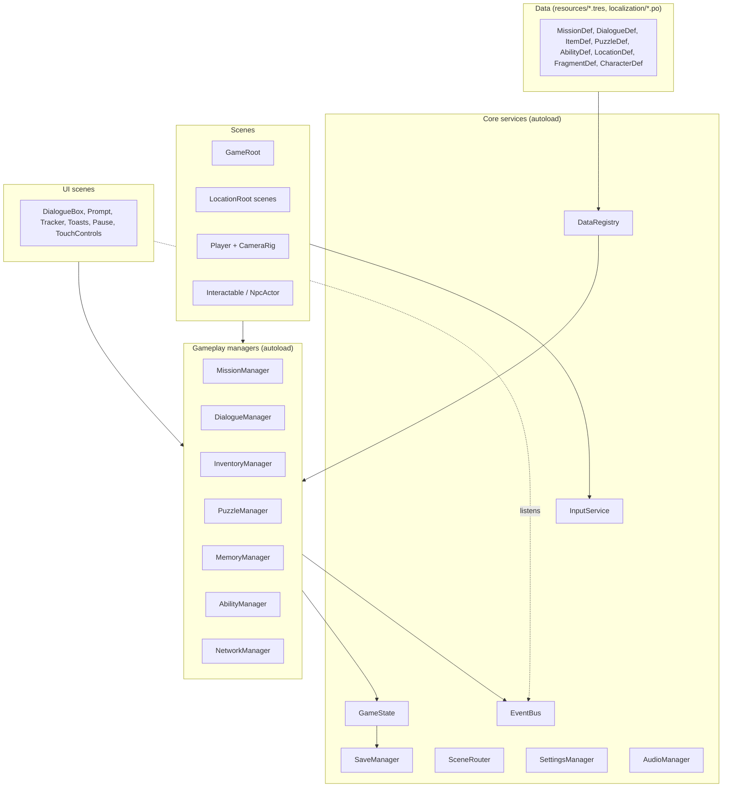
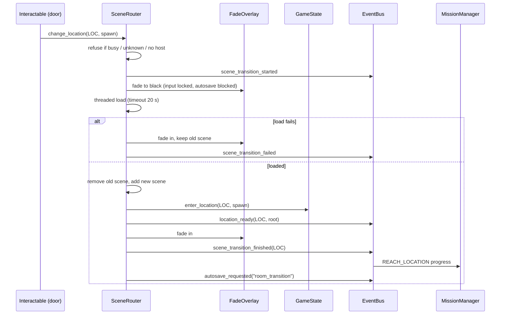
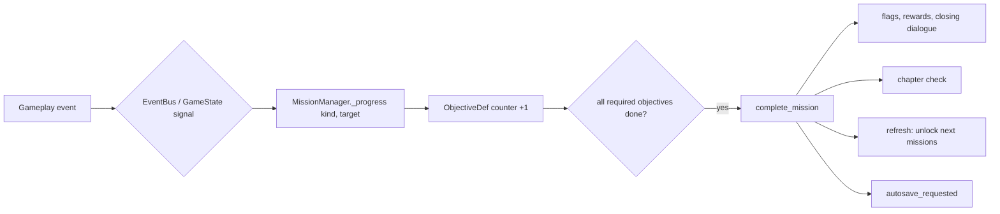
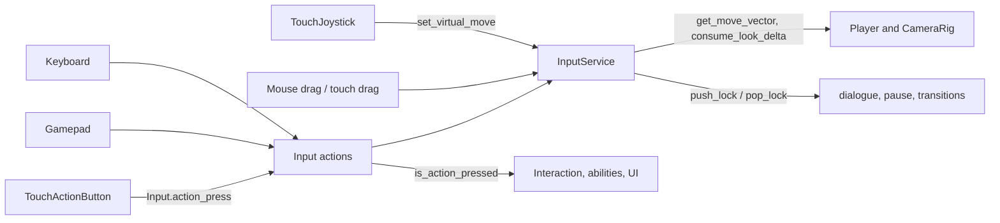

# Project Architecture

## 1. Layers and dependency rules



Rules:
1. **Data layer** has no logic beyond `validate()` and small helpers (`ConditionSet.is_met()`).
2. **GameState** holds data. It never calls a manager.
3. **Managers** may read `DataRegistry` and `GameState`, change `GameState`, call other managers' public methods for rewards, and emit on `EventBus`. They never reference scene nodes.
4. **Scenes** call manager methods (`DialogueManager.start`, `SceneRouter.change_location`) and read state. They never edit `GameState` internals directly.
5. **UI** listens to `EventBus` and calls manager methods. It never contains story data and is never required by a system.
6. Nothing outside `InputService` and the touch controls reads raw input devices.

## 2. Autoload order and why

| # | Autoload | Why here |
|---|---|---|
| 1 | EventBus | Everyone emits through it |
| 2 | DataRegistry | Definitions must exist before managers use them |
| 3 | GameState | Pure data, needs only `LocationIDs` |
| 3b | StoryState | Reads the registry; GameState consults it in debug builds |
| 4 | InputService | Registers the input map in `_init()` |
| 5 | AudioManager | Creates buses before settings apply volumes |
| 6 | SettingsManager | Applies saved settings |
| 7 | SaveManager | Needs GameState and EventBus |
| 8 | SceneRouter | Needs InputService, DataRegistry, GameState |
| 9-13 | Inventory, Memory, Ability, Puzzle managers | Rewards flow Mission -> Ability/Inventory/Memory |
| 14 | ShiftManager, TimeEchoManager, EchoDetection | Ability systems; AbilityManager resets them |
| 15 | ProgressionManager, ObjectiveManager | Objectives feed MissionManager through `mission_objectives_changed` |
| 16 | DialogueManager, MissionManager | Mission rewards may start dialogue |
| 15 | NetworkManager | Optional, independent |

Autoload policy: only services without scene logic become autoloads. Anything that belongs to a place or a level is a scene.

## 3. Scene ownership rules
- **GameRoot** owns: `World` (host node), `Player`, `CameraRig`, the HUD `CanvasLayer`. These persist across locations.
- **A location scene** owns: geometry, lights, `SpawnPoint`s, `Interactable`s, NPC instances. Its root script extends `LocationRoot`. It never owns the player, camera or UI.
- **SceneRouter** is the only code that adds or removes location scenes.
- **NPC scenes** own their mesh, collision and one `Interactable`; all behavior comes from `CharacterDef` and `DialogueDef`.

```
GameRoot
 +- World            (SceneRouter puts the current LocationRoot here)
 +- Player           (CharacterBody3D, InteractionSensor)
 +- CameraRig        (Pitch / Arm / Camera3D)
 +- HUD (CanvasLayer)
     MissionTracker, InteractionPrompt, ToastArea, DialogueBox, TouchControls, PauseMenu
```

## 4. Location transition sequence



## 5. Event catalog (EventBus)

| Group | Signals |
|---|---|
| Scene | `scene_transition_started/finished/failed`, `location_ready` |
| Input | `input_device_changed`, `input_lock_changed` |
| Interaction | `interaction_prompt_changed`, `interaction_hold_progress`, `interaction_completed` |
| Story | `chapter_changed`, `mission_state_changed`, `mission_objective_progress`, `mission_completed` |
| Dialogue | `dialogue_started`, `dialogue_line_shown`, `dialogue_choices_presented`, `dialogue_finished` |
| Collections | `item_added/removed`, `clue_added`, `deduction_made`, `fragment_collected` |
| Abilities / puzzles | `ability_unlocked/activated/ended`, `puzzle_started/hint_given/attempt_failed/solved` |
| Persistence | `autosave_requested`, `save_finished`, `load_finished`, `settings_changed` |
| Story | `story_state_changed`, `info_revealed`, `trace_discovered`, `mission_failed`, `mission_objectives_changed`, `progression_changed` |
| Reality Shift | `shift_state_changed`, `shift_anchor_changed` |
| Time Echo | `echo_site_changed`, `echo_started`, `echo_caption`, `echo_finished`, `echo_recording_changed` |
| Echo Detection | `echo_pulse_fired`, `echo_detected`, `echo_nothing_found` |
| Cinematics | `cutscene_requested` |
| UI | `toast_requested`, `pause_requested` |
| Network | `network_state_changed`, `network_peer_joined/left` |

Conventions: past tense for things that happened, `*_requested` for asks, payloads are ids and primitives (the single exception is `location_ready` which passes the new root node). State owners keep their own signals (`GameState.flag_changed`).

## 6. Mission event flow



## 7. Input architecture



## 8. Extension points

| Need | Extension point |
|---|---|
| New objective type | add a value to `ObjectiveDef.Kind`, a case in `ObjectiveManager._already_true`, and a signal connection in `ObjectiveManager._ready` |
| New puzzle type | `PuzzleRuntime` subclass + case in `PuzzleManager._make_runtime` |
| New ability | `AbilityBehavior` subclass + `AbilityDef` resource |
| New interaction effect | one exported field + one line in `Interactable.interact()` |
| New settings key | one entry in `SettingsManager.SCHEMA` (+ a case in `_apply` if it has an engine effect) |
| New language | `.po` files + one entry in the language setting + project setting |
| New resource kind | `GameDef` subclass, an `IdRules` pattern, a folder entry in `DataRegistry.FOLDERS` |
| New save field | `GameState` var + `to_dict/from_dict` + bump `SAVE_VERSION` + migration step |

## 9. Threading and pausing
- Scene loading uses `ResourceLoader.load_threaded_request`. Everything else runs on the main thread.
- Pause uses `get_tree().paused`; the pause menu has `PROCESS_MODE_ALWAYS`. Input is locked with reason `pause`.

## 10. Networking model (design)
Host-authoritative ENet, 1-4 players, optional. Offline mode behaves as "the host". Campaign systems never call RPCs. Co-op content (Echo Trials) is a separate set of rooms that will use `NetworkManager.is_authority()` before changing shared state.
