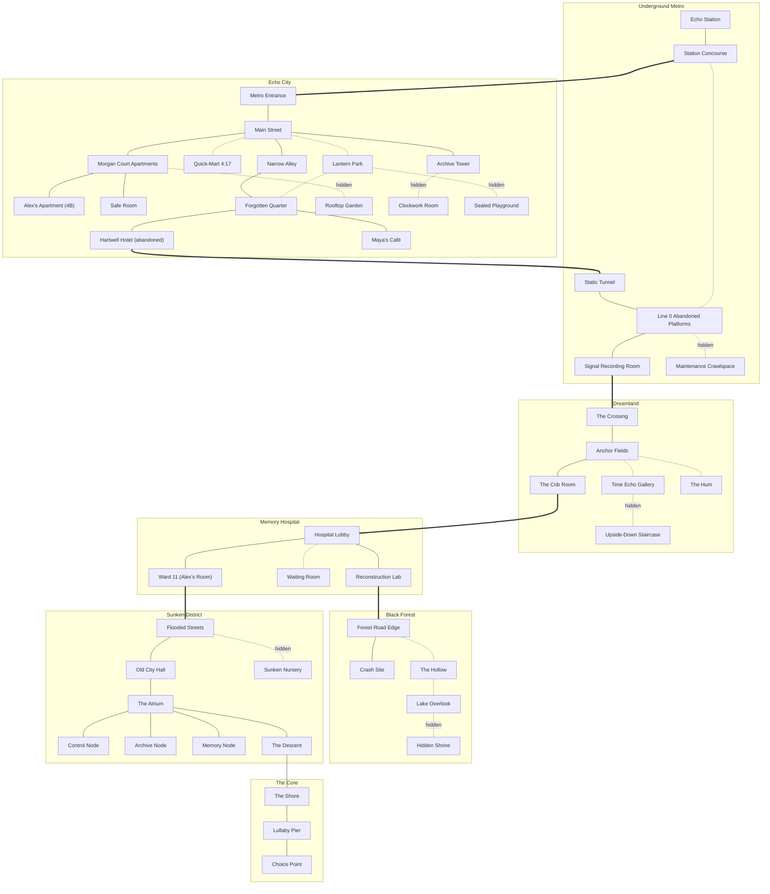

# World Map

Generated from `tools/world_data.py`.

Legend: solid = main route, dotted = optional route, dotted with `hidden` = hidden route, thick = region transition.

## Master map

## Region progression

| Order | Region | Chapter | Enters from | Leaves to |
|---|---|---|---|---|
| 1 | Underground Metro (Echo Station) | 1 | start | Echo City |
| 2 | Echo City | 1–2 | Echo Station | Static Tunnel |
| 3 | Underground Metro (Line 0) | 3 | Static Tunnel | Dreamland |
| 4 | Dreamland | 3 | Recording Room | Memory Hospital |
| 5 | Memory Hospital / Black Forest | 4 | Crib Room | Sunken District |
| 6 | Sunken District | 5 | Ward 11 | The Core |
| 7 | The Core | 6 | The Descent | endings |

## Region transitions

| From | To | Gate chapter | Trigger |
|---|---|---|---|
| `LOC_UM_CONCOURSE` | `LOC_EC_METRO_ENTRANCE` | 1 | Escalator to street |
| `LOC_EC_ABANDONED_BLDG` | `LOC_UM_TUNNEL_STATIC` | 2 | Basement stair to static |
| `LOC_UM_RECORDING_ROOM` | `LOC_DL_CROSSING` | 3 | Static wall |
| `LOC_DL_CRIB_ROOM` | `LOC_MH_LOBBY` | 4 | Monitor tone door |
| `LOC_MH_RECON_LAB` | `LOC_BF_ROAD_EDGE` | 4 | Memory projection |
| `LOC_MH_WARD_ALEX` | `LOC_SD_FLOODED_STREETS` | 5 | Index access door after Ch4 |

## Backtracking and fast travel

- Doors never lock behind the player; all opened routes stay open (Chapter Replay can restore earlier states).
- Safe points (`safe=yes` in LOCATION_REGISTER.md) are save points and fast-travel nodes. Fast travel is allowed between visited safe points inside regions unlocked by the current chapter, and is disabled during pursuit sequences.
- Regions sealed by story: after the Ch5 Atrium collapse, Echo City, Metro, Dreamland, Hospital and Forest are no longer reachable in the main save; Chapter Replay loads them.

## Connection list

| From | To | Route | Opens in Ch | Visual cue |
|---|---|---|---|---|
| `LOC_UM_ECHO_STATION` | `LOC_UM_CONCOURSE` | main | 1 | Stairs |
| `LOC_UM_CONCOURSE` | `LOC_EC_METRO_ENTRANCE` | transition | 1 | Escalator to street |
| `LOC_EC_METRO_ENTRANCE` | `LOC_EC_MAIN_STREET` | main | 1 | Canopy exit |
| `LOC_EC_MAIN_STREET` | `LOC_EC_APT_BLDG` | main | 1 | Lit doorway |
| `LOC_EC_APT_BLDG` | `LOC_EC_ALEX_APT` | main | 1 | Stairwell |
| `LOC_EC_APT_BLDG` | `LOC_EC_SAFE_ROOM` | main | 1 | Basement door |
| `LOC_EC_APT_BLDG` | `LOC_EC_HID_ROOFTOP` | hidden | 1 | Memory Sight reveals ladder |
| `LOC_EC_MAIN_STREET` | `LOC_EC_CONV_STORE` | optional | 1 | Neon sign |
| `LOC_EC_MAIN_STREET` | `LOC_EC_PARK` | optional | 1 | Tree-lined side path |
| `LOC_EC_MAIN_STREET` | `LOC_EC_ARCHIVE_TOWER` | main | 1 | Tower visible at street end |
| `LOC_EC_ARCHIVE_TOWER` | `LOC_EC_HID_CLOCK_ROOM` | hidden | 1 | Ticking behind a panel |
| `LOC_EC_MAIN_STREET` | `LOC_EC_ALLEY` | main | 2 | Alley opens after Archive card |
| `LOC_EC_ALLEY` | `LOC_EC_FORGOTTEN_QUARTER` | main | 2 | Chalk waves lead on |
| `LOC_EC_FORGOTTEN_QUARTER` | `LOC_EC_MAYA_CAFE` | main | 2 | Warm light |
| `LOC_EC_FORGOTTEN_QUARTER` | `LOC_EC_ABANDONED_BLDG` | main | 2 | Broken revolving door |
| `LOC_EC_PARK` | `LOC_EC_FORGOTTEN_QUARTER` | optional | 2 | Shortcut gate |
| `LOC_EC_PARK` | `LOC_EC_HID_PLAYGROUND` | hidden | 2 | Hidden gate (Memory Sight) |
| `LOC_EC_ABANDONED_BLDG` | `LOC_UM_TUNNEL_STATIC` | transition | 2 | Basement stair to static |
| `LOC_UM_TUNNEL_STATIC` | `LOC_UM_ABANDONED_PLATFORMS` | main | 3 | Static dissolves |
| `LOC_UM_CONCOURSE` | `LOC_UM_ABANDONED_PLATFORMS` | optional | 3 | Shortcut gate opened from Line 0 |
| `LOC_UM_ABANDONED_PLATFORMS` | `LOC_UM_RECORDING_ROOM` | main | 3 | Service door |
| `LOC_UM_ABANDONED_PLATFORMS` | `LOC_UM_HID_MAINTENANCE` | hidden | 3 | Vent grate |
| `LOC_UM_RECORDING_ROOM` | `LOC_DL_CROSSING` | transition | 3 | Static wall |
| `LOC_DL_CROSSING` | `LOC_DL_ANCHOR_FIELDS` | main | 3 | Floating bridge |
| `LOC_DL_ANCHOR_FIELDS` | `LOC_DL_CRIB_ROOM` | main | 3 | Door appears after 3 anchors |
| `LOC_DL_ANCHOR_FIELDS` | `LOC_DL_ECHO_GALLERY` | optional | 3 | Side door |
| `LOC_DL_ANCHOR_FIELDS` | `LOC_DL_THE_HUM` | optional | 3 | Low sound |
| `LOC_DL_ECHO_GALLERY` | `LOC_DL_HID_UPSIDE_STAIRS` | hidden | 3 | Reality Shift |
| `LOC_DL_CRIB_ROOM` | `LOC_MH_LOBBY` | transition | 4 | Monitor tone door |
| `LOC_MH_LOBBY` | `LOC_MH_WARD_ALEX` | main | 4 | Elevator |
| `LOC_MH_LOBBY` | `LOC_MH_WAITING_ROOM` | optional | 4 | Corridor |
| `LOC_MH_LOBBY` | `LOC_MH_RECON_LAB` | main | 4 | Lab corridor |
| `LOC_MH_RECON_LAB` | `LOC_BF_ROAD_EDGE` | transition | 4 | Memory projection |
| `LOC_BF_ROAD_EDGE` | `LOC_BF_CRASH_SITE` | main | 4 | Road |
| `LOC_BF_ROAD_EDGE` | `LOC_BF_HOLLOW` | optional | 4 | Deer trail |
| `LOC_BF_HOLLOW` | `LOC_BF_LAKE_OVERLOOK` | optional | 4 | Totem path |
| `LOC_BF_LAKE_OVERLOOK` | `LOC_BF_HID_SHRINE` | hidden | 4 | Hidden stair |
| `LOC_MH_WARD_ALEX` | `LOC_SD_FLOODED_STREETS` | transition | 5 | Index access door after Ch4 |
| `LOC_SD_FLOODED_STREETS` | `LOC_SD_OLD_CITY_HALL` | main | 5 | Steps above water |
| `LOC_SD_OLD_CITY_HALL` | `LOC_SD_ATRIUM` | main | 5 | Great doors |
| `LOC_SD_ATRIUM` | `LOC_SD_NODE_CONTROL` | main | 5 | Ring corridor |
| `LOC_SD_ATRIUM` | `LOC_SD_NODE_ARCHIVE` | main | 5 | Ring corridor |
| `LOC_SD_ATRIUM` | `LOC_SD_NODE_MEMORY` | main | 5 | Ring corridor |
| `LOC_SD_FLOODED_STREETS` | `LOC_SD_HID_NURSERY` | hidden | 5 | Submerged door (Reality Shift) |
| `LOC_SD_ATRIUM` | `LOC_SD_DESCENT` | main | 6 | Floor collapses |
| `LOC_SD_DESCENT` | `LOC_CR_SHORE` | main | 6 | Fall ends at shoreline |
| `LOC_CR_SHORE` | `LOC_CR_LULLABY_PIER` | main | 6 | Pier |
| `LOC_CR_LULLABY_PIER` | `LOC_CR_CHOICE_POINT` | main | 6 | Pier end |
